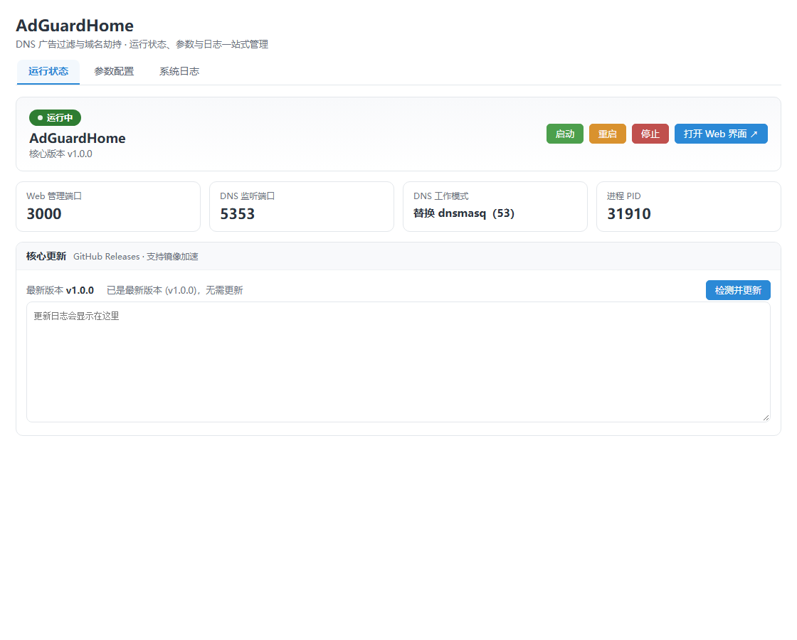
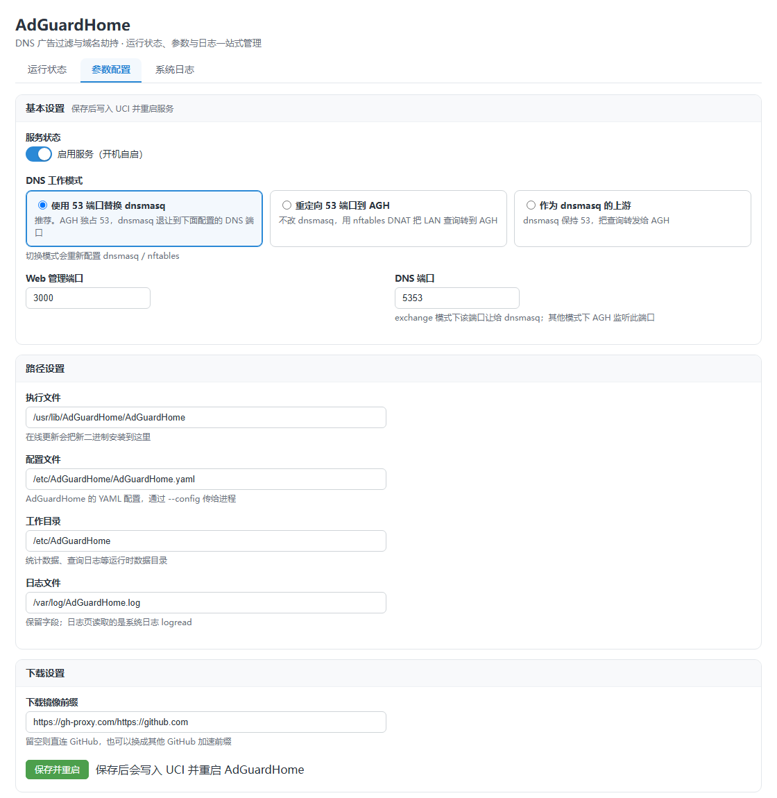
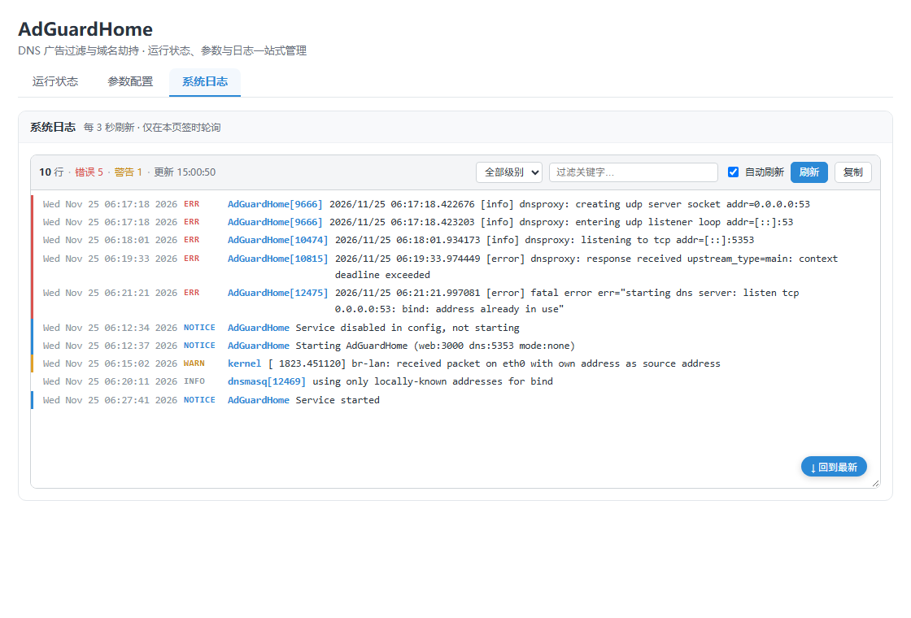
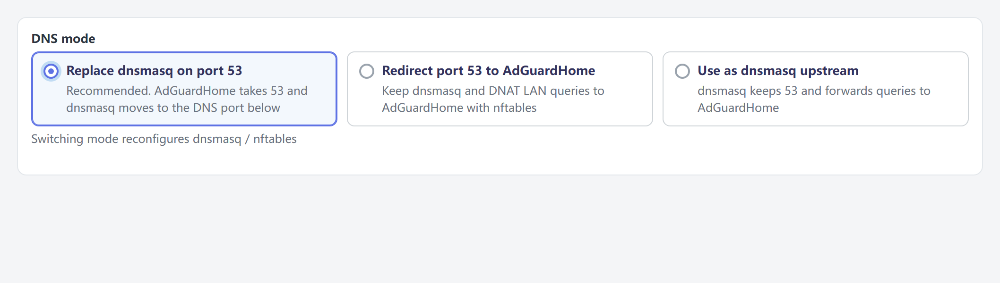

# luci-app-adguardhome


OpenWrt 25.12+ 的 **AdGuardHome** LuCI 插件：纯 JavaScript + Shell CGI，零 Lua。

- 三个页签：运行状态、参数配置、系统日志
- 四种 DNS 接管方式：`exchange` / `redirect` / `dnsmasq-upstream` / `none`
- 在线更新核心，自动校验官方 `checksums.txt`，升级前备份且只保留最近一份
- CGI 接口校验 LuCI 登录态，未登录直接 403
- 中英文界面，跟随 LuCI 语言设置
- 不依赖 Python/Node/编译工具，装上即用

> 当前版本 **2.0.0**。改动记录见 [CHANGES.md](CHANGES.md)。

---

## 截图

| 运行状态 | 参数配置 |
|---|---|
|  |  |

| 系统日志 | DNS 模式卡片 |
|---|---|
|  |  |

> 预览图是离线渲染的，不是路由器截图；实际配色跟随 LuCI 主题（Argon 等）。

---

## 功能

| 功能 | 说明 |
|---|---|
| **状态页** | 运行状态胶囊、Web/DNS 端口、工作模式、PID；启动/停止/重启；一键打开 AGH 自带 Web（`:3000`）；在线检测并更新（进度条 + 下载日志） |
| **配置页** | 启停开关、DNS 模式三选一卡片、Web/DNS 端口、二进制/配置/工作目录路径、下载镜像前缀；保存后写入 UCI 并重启服务 |
| **日志页** | 级别筛选、关键字过滤、错误/警告高亮、一键复制、回到最新；只在本页签打开时每 3 秒轮询 |
| **DNS 接管** | 交换端口 / nftables 本地重定向 / dnsmasq 上游，三种方式覆盖不同场景 |
| **在线更新** | GitHub Releases（支持镜像加速）、架构识别、checksums 校验、失败回滚提示、备份清理 |
| **鉴权** | CGI 用 LuCI 会话校验，未登录 `403`；错误以稳定错误码返回，由前端翻译 |
| **多语言** | 英文 msgid + zh-cn `.po`/`.lmo`，LuCI 自动合并到 `window.TR` |
| **生命周期** | procd 管理、开机自启、停止时还原 dnsmasq/nftables、重启时避免 YAML 竞态 |

---

## 系统要求

- OpenWrt **25.12 或更新**（apk 包管理）
- LuCI（JavaScript 版，非 Lua 版）
- 约 40 MB 空闲空间（AdGuardHome 核心约 30 MB + 备份）
- 支持架构：x86_64、aarch64、armv7、armv6、armv5、riscv64、mips/mips64（大小端）等，更新脚本会按 `uname` 自动识别

---

## 安装

### ⚠️ 先看：与官方包同名

本包与 OpenWrt 官方 luci feed 里的 `luci-app-adguardhome` **同名**（不是同一个项目）。
两者不要混装，安装前先卸载官方版：

```sh
apk del luci-app-adguardhome 2>/dev/null
```

### 0. 下载

从 [Releases](https://github.com/firely26710/luci-app-adguardhome/releases) 下载
`luci-app-adguardhome-2.0.0-r2.apk`（SHA-256 `9bb87598…`），或自行构建。

### 1. 解锁未签名包（只需一次）

OpenWrt 25.12 默认只信任官方签名的 APK。使用未签名包时先解锁：

```sh
wget -O toggle.sh https://cafe.cpolar.cn/wkdaily/cool/raw/branch/master/apk-untrusted-toggle.sh && sh toggle.sh
```

> 参考视频：[OpenWrt 25.12.x APK 安装教程](https://www.bilibili.com/video/BV1aKJp6KEDG/)（作者：[悟空的日常](https://github.com/wukongdaily)）

如果包是用**你路由器已信任的密钥**签的（例如用本机 OpenWrt 构建树打包），可以跳过解锁，直接：

```sh
apk add ./luci-app-adguardhome-2.0.0-r2.apk
```

### 2. 安装

LuCI 界面：**系统 → 软件包 → 上传软件包**，选择 `.apk`。

或命令行：

```sh
apk add --allow-untrusted ./luci-app-adguardhome-2.0.0-r2.apk
```

安装脚本会自动设置权限、注册开机自启、清理 LuCI 缓存。

### 3. 下载 AdGuardHome 核心

插件本身不带核心二进制。安装后在 **服务 → AdGuardHome → 运行状态** 点击「检测并更新」，
或手动把二进制放到 `/usr/lib/AdGuardHome/AdGuardHome`。

### 4. 初始化 AdGuardHome

首次打开 `http://路由器IP:3000` 会进入 AGH 自己的安装向导，创建管理员账号。

> **重要**：向导默认上游是 Cloudflare DoH（`https://cloudflare-dns.com/dns-query`），
> 在部分网络（尤其是国内）不可达，会表现为“插件正常但 DNS 不解析”。
> 请在 AGH 的 **设置 → DNS 设置** 里改成可用的上游，例如
> `223.5.5.5`、`119.29.29.29`，或你自建的 DNS。

---

## 签名与信任（新手看这里）

- OpenWrt 25.12 默认只信任 `/etc/apk/keys/` 里的公钥；签名对不上就报 `UNTRUSTED signature`。
- **临时放行**：`apk add --allow-untrusted 包.apk`，或先跑一次解锁脚本。
- **长期免解锁**：自己生成一对密钥，用私钥 `--sign` 打包，把公钥放进 `/etc/apk/keys/`
  （文件名随意，apk 按内容匹配）。之后 `apk add` 直接通过。
- 本仓库 Release 里的包是用作者构建树的密钥签的，你的路由器通常不信任那把钥匙，
  所以对你而言仍按“未签名”处理。

完整步骤（生成密钥、签名、验证、取消信任、常见坑）见
[docs/signing.md](docs/signing.md)。

---

## 快速开始

1. 安装插件 + 下载核心；
2. 打开 `:3000` 完成 AGH 向导，设置上游 DNS；
3. 回到 LuCI → 参数配置，DNS 模式选 **使用 53 端口替换 dnsmasq**（默认）；
4. 保存并重启；
5. 在客户端执行 `nslookup example.com 路由器IP`，能解析即成功；
6. 打开 AGH 的「查询日志」，能看到客户端查询记录。

> **新手不用担心**：按钮点错了不会坏，最差是在 LuCI 里重启一下服务；出问题先看「系统日志」页。

---

## DNS 模式

| UCI 值 | LuCI 显示 | 做了什么 | 适合场景 |
|--------|----------|---------|---------|
| `exchange` | 使用 53 端口替换 dnsmasq | AdGuardHome 独占 53，dnsmasq 退到 `adh_port`（默认 5353） | **默认/推荐**，简单直接 |
| `redirect` | 重定向 53 端口到 AdGuardHome | nftables 本地重定向：`br-lan` :53 → AGH 端口，保留客户端 IP | 不想动 dnsmasq 端口时 |
| `dnsmasq-upstream` | 作为 dnsmasq 的上游 | dnsmasq 保持 :53，设置 `server=127.0.0.1#adh_port` | 需要 dnsmasq 继续处理 DHCP DNS 时 |
| `none` | （仅 UCI） | 不做任何劫持，AGH 监听 `adh_port` | 调试 / 只使用 AGH 的 Web 功能 |
| `replace` | （旧版，已废弃） | 全接口重定向 :53 → AGH | 不推荐 |

> **`adh_port` 的含义随模式变化**：
> `exchange` 下它是 dnsmasq 让出来的端口（AGH 用 53）；其余模式下它是 AGH 自己监听的端口。
> 状态页显示的“DNS 端口”是 AGH 实际监听的端口（`exchange` 下显示 53）。

> **redirect 为什么不是 DNAT 到 127.0.0.1**：
> 那需要 `net.ipv4.conf.<if>.route_localnet=1`，OpenWrt 默认关闭，规则会静默失效。
> 这里用 nftables 的 `redirect to :端口`，不依赖 sysctl，并且保留客户端源 IP。

### 三种模式怎么选

```
exchange（推荐）         redirect                  dnsmasq-upstream
─────────────────      ─────────────────         ──────────────────
 AGH 直接占 :53         nftables 重定向到 :5353     dnsmasq 转发到 :5353
 dnsmasq 退到 :5353     dnsmasq 保持 :53           dnsmasq 保持 :53
 零额外开销              每个包多一次重定向           每查询多一次转发
 兼容性最好              不改 dnsmasq               兼容性最好
```

---

## UCI 配置参考

文件位置：`/etc/config/adguardhome`

```ini
config adguardhome 'main'
    option enabled '1'              # 1=启用服务, 0=禁用
    option dns_mode 'exchange'      # DNS 模式（见上表）
    option web_port '3000'          # AGH 自带 Web 管理界面端口
    option adh_port '5353'          # exchange 下给 dnsmasq；其余模式为 AGH 的 DNS 端口
    option binary_path '/usr/lib/AdGuardHome/AdGuardHome'   # 二进制路径
    option config_path '/etc/AdGuardHome/AdGuardHome.yaml'  # AGH YAML 配置
    option work_dir '/etc/AdGuardHome'                      # AGH 工作目录（数据存储）
    option log_file '/var/log/AdGuardHome.log'              # 保留字段（当前未传给进程）
    option dl_mirror_prefix 'https://gh-proxy.com/https://github.com'  # 下载镜像前缀
```

| 选项 | 默认值 | 说明 |
|------|--------|------|
| `enabled` | `1` | 设为 `0` 后即使 init 脚本被调用也不会启动进程 |
| `dns_mode` | `exchange` | 详见上方 DNS 模式章节 |
| `web_port` | `3000` | 访问 `http://路由器IP:3000` 进入 AGH 自带管理界面；会以 `--web-addr` 传给进程 |
| `adh_port` | `5353` | `exchange` 下是 dnsmasq 让出的端口；其余模式下是 AGH 监听的 DNS 端口 |
| `binary_path` | `/usr/lib/AdGuardHome/AdGuardHome` | 下载更新也安装到这里 |
| `config_path` | `/etc/AdGuardHome/AdGuardHome.yaml` | 通过 `--config` 传给 AGH 进程 |
| `work_dir` | `/etc/AdGuardHome` | AGH 的数据目录（统计、查询日志） |
| `log_file` | `/var/log/AdGuardHome.log` | 保留字段；日志页读取的是 `logread` |
| `dl_mirror_prefix` | `https://gh-proxy.com/https://github.com` | GitHub 下载镜像，可换其他加速服务 |

---

## 与 OpenClash 共存

两者都想控制 DNS，推荐 **AGH 在前、Clash 在后**：

```
┌─────────┐ :53 ┌──────────────┐ :7874 ┌──────────────────┐ ┌──────────┐
│ 客户端   │ ──→ │ AdGuardHome  │ ────→ │ OpenClash DNS    │ ──→ │ 上游 DNS │
│         │     │ 广告过滤/日志  │       │ GFW分流/代理      │   │          │
└─────────┘     └──────────────┘       └──────────────────┘   └──────────┘
```

**AdGuardHome 侧**：DNS 模式选 `exchange`；在 AGH Web 界面把上游改成 `127.0.0.1:7874`。

**OpenClash 侧**：关闭「本地 DNS 劫持」，关闭「禁止 Dnsmasq 缓存」。

注意事项：

- 该方案下 OpenClash 的 **Fake-IP 不可用**；
- 如需 Fake-IP，改成 Clash 在前 + AGH 用 `dnsmasq-upstream`，但 AGH 只能看到 `127.0.0.1`；
- `redirect` 与 OpenClash 的 DNS 劫持会在同一个 `dstnat` 链里抢匹配，共存场景优先 `exchange`。

---

## 文件结构

```
luci-app-adguardhome/
├── Makefile                                      # APK 打包定义（含 postinst/prerm）
├── README.md
├── CHANGES.md                                    # 改动记录（含实测结果）
├── LICENSE
├── docs/
│   ├── build-apk.md                              # 本地打包 .apk 的两种方式
│   └── ui-preview/                               # UI 预览图（离线渲染）
├── po/zh-cn/                                     # 翻译源文件（英文 msgid → 中文）
├── i18n/                                         # 编译产物（.lmo，装到 LuCI）
├── tools/mklmo.py                                # .po → .lmo（不依赖 po2lmo）
├── etc/
│   ├── config/adguardhome                        # UCI 默认配置
│   └── init.d/AdGuardHome                        # procd 启动脚本（~330 行）
├── usr/
│   ├── bin/agh-update                            # 在线更新脚本（~270 行）
│   └── share/
│       ├── luci/menu.d/luci-app-adguardhome.json
│       └── rpcd/acl.d/luci-app-adguardhome.json
└── www/
    ├── cgi-bin/agh-api                           # CGI 后端（~200 行）
    └── luci-static/resources/view/adguardhome/
        └── main.js                               # 前端（~690 行）
```

| 文件 | 语言 | 职责 |
|------|------|------|
| `etc/init.d/AdGuardHome` | Shell | procd 进程管理、三种 DNS 模式、nftables 规则、dnsmasq 联动 |
| `usr/bin/agh-update` | Shell | 架构识别、下载、checksums 校验、替换二进制、备份清理 |
| `www/cgi-bin/agh-api` | Shell | 状态/启停/配置/日志/更新进度，登录态校验 |
| `www/.../main.js` | JavaScript | 三个页签的 UI 与交互 |
| `po/` + `i18n/` | gettext | 翻译源文件与编译产物 |
| `tools/mklmo.py` | Python（构建期） | `.po` → `.lmo`，运行时不安装 |

### 数据流

```
浏览器 LuCI 页面
  │ main.js → /cgi-bin/agh-api?action=xxx
  ▼
uhttpd 执行 agh-api (Shell CGI)
  │ 读写 UCI、操作 init.d、调用 agh-update
  ▼
/etc/init.d/AdGuardHome (procd)
  │ 启停 AGH、生成 nftables 规则、修改 dnsmasq
  ▼
/usr/lib/AdGuardHome/AdGuardHome（官方二进制）
```

---

## CGI API

所有接口返回 JSON，**需要 LuCI 登录态**；未登录/会话失效返回 `403`。

浏览器会把会话 id 写入同源 cookie `agh_sid`。命令行调试：

```sh
curl -c /tmp/luci.jar -X POST http://路由器IP/cgi-bin/luci \
  --data-urlencode 'luci_username=root' --data-urlencode 'luci_password=密码'

SID=$(awk '/sysauth_http/{print $7}' /tmp/luci.jar)
curl -b "agh_sid=$SID" 'http://路由器IP/cgi-bin/agh-api?action=status'
```

| `action=` | 说明 |
|-----------|------|
| `status` | 服务状态（运行中、PID、端口、版本） |
| `start` / `stop` / `restart` | 启停服务 |
| `get_log&lines=N` | 读取系统日志最后 N 行 |
| `get_config` / `save_config` | 读写 UCI 配置（`save_config` 会重启服务） |
| `get_yaml` / `save_yaml` | 读写 AGH 的 YAML（高级用法，前端未使用） |
| `check_update` | 检查 GitHub 最新版本 |
| `update&version=vX.Y.Z` | 后台下载指定版本，版本号会做格式校验 |
| `update_progress` | 进度 0–100；`-1` 表示失败 |

错误码（前端负责翻译）：`unauthorized`、`version_required`、`invalid_version`、
`latest_version_unavailable`。

---

## 多语言

- 源码用英文 msgid（`_('System log')`）；
- `po/zh-cn/luci-app-adguardhome.po` 提供中文；
- `i18n/luci-app-adguardhome.zh-cn.lmo` 装到 `/usr/lib/lua/luci/i18n/`；
- LuCI 按当前语言合并成 `window.TR`。

新增语言：

```sh
cp -r po/zh-cn po/de
# 翻译 po/de/*.po 后编译
python3 tools/mklmo.py po/de/luci-app-adguardhome.po i18n/luci-app-adguardhome.de.lmo
```

> `_()` 的 key 是 msgid 的哈希，改文案必须同步改 `.po` 并重新生成 `.lmo`。

---

## 构建与打包

本包不依赖 luci.mk，可直接用 OpenWrt SDK 或任意已编译的 OpenWrt 树打包：

```sh
# 在 OpenWrt SDK / 源码树中
cp -r luci-app-adguardhome package/
make package/luci-app-adguardhome/compile V=s
```

APK 是 apk-tools v3 的 ADB 容器，不能手工 tar；两种本地打包方式（含签名、密钥匹配、
`apk verify`）见 [docs/build-apk.md](docs/build-apk.md)。

版本号在 `Makefile`：`PKG_VERSION` / `PKG_RELEASE`，产物名为
`luci-app-adguardhome-<version>-r<release>.apk`。

---

## 更新日志

见 [CHANGES.md](CHANGES.md)：按 init / 更新脚本 / CGI / 前端 / i18n / 打包分节，
包含路由器实测结果和已知限制。

---

## 常见问题

### 安装后 LuCI 菜单没出现？

```sh
rm -f /tmp/luci-indexcache* /tmp/luci-modulecache/*
```

然后重新登录 LuCI。

### 提示签名不受信任？

说明包不是用你路由器信任的密钥签的。两条路：执行上面的解锁脚本，或
`apk add --allow-untrusted`。自己用路由器同款构建树签名的包不需要。

### 和官方 luci-app-adguardhome 冲突？

同名不同项目，先 `apk del luci-app-adguardhome` 再装本包，不要混装。

### 服务显示“已停止”？

确认核心存在且可执行：

```sh
ls -la /usr/lib/AdGuardHome/AdGuardHome
```

没有就在状态页点「检测并更新」。

### 插件正常但 DNS 不解析？

先看 AGH 的查询日志有没有记录：

- 没有记录 → DNS 没被接管：检查模式、`adh_port`、nft 规则；
- 有记录但超时/失败 → 上游不可达：到 AGH Web 界面改上游（向导默认 DoH 可能被墙）。

### redirect 模式不生效？

```sh
nft list chain inet fw4 adguardhome_dns
```

没有输出就重启防火墙：`/etc/init.d/firewall reload`。

### exchange 下 dnsmasq 端口不对？

```sh
uci get dhcp.@dnsmasq[0].port    # 应为 5353（或你设置的 adh_port）
```

### AGH Web（:3000）打不开？

```sh
/etc/init.d/AdGuardHome status
netstat -tlnp | grep AdGuard
```

并确认防火墙没有拦截 3000。

### 下载太慢/失败？

参数配置里换 `dl_mirror_prefix`，或手动下载后放到 `binary_path`。

---

## 卸载

```sh
apk del luci-app-adguardhome
```

`pre-deinstall` 会停服务、清理 nft 规则并关闭自启。

> 注意：`apk del` 会一并删除 `/etc/config/adguardhome`；重装会恢复默认配置。
> AGH 自己的数据目录 `/etc/AdGuardHome`（含 YAML、统计、查询日志）和核心二进制
> 不归包管理，需要手动删除。

---

## 已知限制

- `log_file` 仍是保留字段，未传给 AGH 进程（日志页读 syslog）；
- 登录态过期后只提示一次，不会自动跳登录页；
- `redirect` 规则里 LAN 接口写死 `br-lan`，接口命名不同的固件需自行调整；
- 升级场景下 conffiles 合并未实测；`apk del` 会删配置；
- 只验证过 x86_64 实机，其他架构的二进制下载路径来自官方命名规则，未逐一实测。

---

## 关于这个项目

我是新手。1.x 是用 [Claude Code](https://github.com/anthropics/claude-code) 参考
[AdGuardHome 官方](https://github.com/AdguardTeam/AdguardHome) 安装脚本写出来的；
**2.0.0 这一版（DNS 模式修复、三页签 UI 重做、i18n、签名打包与文档）由
DSH（DeepSeek Harness）AI agent 完成**。整个过程都是
一个人 + AI：说需求 → 写代码 → 路由器实测 → 迭代修复。

不是官方项目，也不是旧版 Lua 插件的移植。没有历史包袱，所以能做到零 Lua、纯 JS + Shell。

- init 脚本 ~330 行、CGI ~200 行、前端 ~690 行、更新脚本 ~270 行；
- 进程管理（procd）、DNS 接管（nftables/dnsmasq）、配置（UCI）、界面（LuCI JS）都是自定义集成；
- 下载更新沿用了官方 Release 的命名与目录结构。

**License**：Apache-2.0，见 [LICENSE](LICENSE)。

AdGuardHome 是 Adguard Software Ltd. 的商标/项目；本项目与官方无隶属关系。